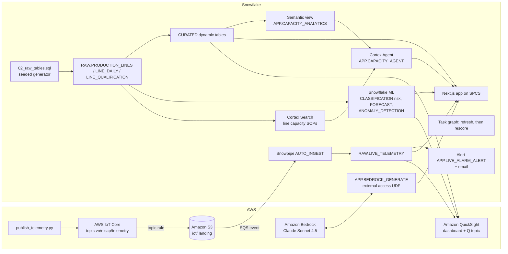

# Vietnam Electronics Line Capacity - Assembly Lines in Northern and Southern Vietnam

Daily capacity planning for **28 electronics assembly lines across 5 Vietnamese cities** (Bac Ninh, Bac Giang, Hai Phong, Thai Nguyen, Bien Hoa) using Snowflake, optionally with AWS: from a live line-state alarm to a 7-day capacity-constraint risk score, an alarm email and an AI action memo for the production planning lead.

## Architecture

The build runs on **Snowflake** (Dynamic Tables, Snowflake ML, Cortex Search, Cortex Agent, Cortex AI_COMPLETE, SPCS) and, in the full build, **AWS** (IoT Core, S3, Bedrock Claude, QuickSight + Amazon Q). Line-state messages (throughput gap, queue depth) land in `RAW.LIVE_TELEMETRY`. Dynamic tables curate 90 days of line-day history: units completed against the committed build plan, queue hours per unit, capacity constraints and line availability. Snowflake ML scores 7-day constraint risk per line, forecasts network-wide plan attainment and flags throughput gap anomalies. A Cortex Agent answers questions with SOP citations, and an LLM drafts the capacity action memo.

Interactive diagrams (hover for object names): [Snowflake only](docs/architecture-snowflake.html) | [AWS + Snowflake](docs/architecture-aws.html). The app shows both on its Architecture & Data tab, the current build first. Regenerate them with `python3 docs/build_architecture.py aws snowflake`.



The Snowflake-only build drops the AWS subgraph: `APP.SIMULATE_TELEMETRY` writes to `RAW.LIVE_TELEMETRY`, and the app calls Cortex `AI_COMPLETE` instead of the Bedrock UDF.

## Snowflake Capabilities

| Capability | Implementation |
|-----------|---------------|
| Dynamic Tables | `CURATED.KPI_SUMMARY`, `PERFORMANCE_SUMMARY`, `CONSTRAINT_CAUSES`, `TREND_ANALYSIS` from the RAW tables |
| Snowflake ML | CLASSIFICATION 7-day capacity-constraint risk (`ML.CONSTRAINT_RISK_SCORES`), 14-day plan-attainment FORECAST, throughput gap ANOMALY_DETECTION |
| Cortex Search | 18 synthetic line capacity SOPs (one per line type and cause) in `SEARCH.CAPACITY_SOP_SEARCH` |
| Semantic View | `APP.CAPACITY_ANALYTICS` over assembly lines, constraint causes, daily plan attainment and risk |
| Cortex Agent | `APP.CAPACITY_AGENT`: Cortex Analyst over the semantic view plus Cortex Search for SOP citations |
| Cortex AI | `AI_COMPLETE('claude-sonnet-4-5')` for grounded answers, and for the action memo in the Snowflake-only build |
| Alerts + Tasks | `APP.LIVE_ALARM_ALERT` logs ALARM readings and sends email; task graph `TASK_REFRESH_CURATED`, then `TASK_RESCORE_RISK` |
| Snowpark Container Services | Next.js app `APP.VN_ELECTRONICS_CAPACITY_APP` with 6 tabs: Executive Cockpit, Predictive, Capacity Health, Live IoT, Ask AI, Architecture & Data |
| Snowpipe | `RAW.LIVE_TELEMETRY_PIPE` AUTO_INGEST from S3 (AWS build only) |

## AWS Services

Used only in the AWS + Snowflake build.

| Service | Role in Demo |
|---------|-------------|
| AWS IoT Core | Receives simulated line-state messages (throughput gap, queue depth) from line controllers. A topic rule writes each message to S3 |
| Amazon S3 | Landing bucket. An event notification goes to the Snowpipe SQS queue |
| Amazon Bedrock | Claude Sonnet 4.5 writes the action memo, called from Snowflake through an external-access UDF |
| Amazon QuickSight | DIRECT_QUERY executive dashboard over Snowflake (daily plan attainment, constraints by line, constraint risk) |
| Amazon Q | Natural-language questions over the QuickSight topic `vn-electronics-capacity-topic` |
| AWS IAM | Least-privilege roles for S3, IoT and Bedrock |

## Personas

These personas are fictional.

| Persona | Role | Key Questions |
|---------|------|---------------|
| **Pham Thu Ha** | Director of Production Planning | "Which lines miss their committed build plan most often?" "Which constraint causes cost us the most units?" |
| **Le Minh Tuan** | Line Capacity Planner | "Which lines are high constraint risk this week, and which SOP applies?" |

## Data

All data is synthetic and seeded, so every rebuild reproduces it. Plants, lines, customers and planners are fictional; the five cities are Vietnamese cities used as regions, and no figure describes a real plant or company.

| Table | Rows | Description |
|-------|------|-------------|
| RAW.PRODUCTION_LINES | 28 | Assembly lines across 5 cities and 5 line types (SMT, Through-Hole and Wave, Final Assembly, Functional Test, Box Build and Packing), with a qualified units-per-hour rate |
| RAW.LINE_DAILY | 2,520 | Daily line observations over 90 days: units released, committed and completed, queue hours, constraints, root cause, lost hours, PM, throughput gap and queue depth |
| RAW.LINE_QUALIFICATION | 28 | Stations required to build each line's critical product family with one station down, stations qualified and stations in qualification |
| SEARCH.CAPACITY_DOCS | 18 | Synthetic line capacity SOPs indexed for Cortex Search |
| RAW.LIVE_TELEMETRY | Grows during the demo | Live readings from IoT Core (AWS build) or `APP.SIMULATE_TELEMETRY` (Snowflake-only build) |
| ML.CONSTRAINT_RISK_SCORES | 28 | 7-day capacity-constraint probability and risk band per line |

## Build Instructions

### Prerequisites
- Snowflake account with ACCOUNTADMIN access, and Cortex AI enabled (AI_COMPLETE, Search, Agent).
- An X-Small warehouse with auto-suspend at or below 120 s, and an existing SPCS compute pool.
- Python 3.11+, `snowflake-connector-python`, Node.js 22+, Docker and the `snow` CLI.
- App image: run `snow spcs image-registry login`, then build and push `vn-electronics-capacity-app:v1` to the database's `APP.IMAGES` repository (see the header of `snowflake/07_deploy_app.sql`).
- AWS build only: `boto3`, AWS credentials for the target account (us-west-2) with Bedrock access, and QuickSight Enterprise.

### SPCS App
```
<DATABASE>.APP.VN_ELECTRONICS_CAPACITY_APP
```

### Tests
```bash
python -m pytest aws snowflake quicksight
```

For a local run, put `SNOWFLAKE_ACCOUNT`, `SNOWFLAKE_USER`, `SNOWFLAKE_DATABASE`, `SNOWFLAKE_WAREHOUSE`, `SNOWFLAKE_AUTHENTICATOR=PROGRAMMATIC_ACCESS_TOKEN`, `SNOWFLAKE_TOKEN` and `DEMO_PLATFORM` in the environment, then run `npm --prefix app run build && npm --prefix app start`.

## Build Modes

Both modes share the same core. They differ in three places, and the app's `DEMO_PLATFORM` setting (in its SPCS spec) switches the memo provider and the Live IoT tab.

| Layer | Snowflake Only | Full AWS + Snowflake |
|---|---|---|
| Live telemetry | `CALL APP.SIMULATE_TELEMETRY(n)` inserts simulated readings into `RAW.LIVE_TELEMETRY`. This simulates a line-state feed; it is not Snowpipe Streaming | `aws/publish_telemetry.py` to AWS IoT Core, then S3, SQS and Snowpipe AUTO_INGEST |
| Action memo | Cortex `AI_COMPLETE('claude-sonnet-4-5')` | Amazon Bedrock Claude Sonnet 4.5 through `APP.BEDROCK_GENERATE` |
| BI and natural-language questions | The SPCS app is the dashboard; questions go to the Cortex Agent | Also a QuickSight dashboard and an Amazon Q topic |
| App setting | `DEMO_PLATFORM: snowflake` | `DEMO_PLATFORM: aws` |

### Snowflake Only

```bash
# 1. Core data and dynamic tables (guarded: new isolated database only)
python snowflake/run_core.py --database VIETNAM_ELECTRONICS_CAPACITY_SNOWFLAKE --warehouse <XS_WAREHOUSE> --connection <CONNECTION> --apply
# 2. Native telemetry, ML, search, semantic view, agent, alert and task graph
python snowflake/run_intelligence.py --database VIETNAM_ELECTRONICS_CAPACITY_SNOWFLAKE --platform snowflake --warehouse <XS_WAREHOUSE> --connection <CONNECTION> --alert-email you@example.com
# 3. App on SPCS with DEMO_PLATFORM=snowflake (push the image first)
python snowflake/run_intelligence.py --database VIETNAM_ELECTRONICS_CAPACITY_SNOWFLAKE --platform snowflake --warehouse <XS_WAREHOUSE> --connection <CONNECTION> --alert-email you@example.com --files 07_deploy_app.sql --compute-pool <COMPUTE_POOL>
```

During the demo:
- Run `CALL APP.SIMULATE_TELEMETRY(20)` to add live readings. For a continuous feed, run `ALTER TASK APP.TASK_SIMULATE_TELEMETRY RESUME`, and `SUSPEND` it afterwards.
- Run `EXECUTE ALERT APP.LIVE_ALARM_ALERT` to raise the alarm email.
- Run `EXECUTE TASK APP.TASK_REFRESH_CURATED` to refresh the curated tables and rescore risk.

Afterwards, drop the database or run `ALTER SERVICE APP.VN_ELECTRONICS_CAPACITY_APP SUSPEND`.

### Full AWS + Snowflake

```bash
# 1. Core data and dynamic tables (guarded: new isolated database only)
python snowflake/run_core.py --database VIETNAM_ELECTRONICS_CAPACITY_AWS --warehouse <XS_WAREHOUSE> --connection <CONNECTION> --apply
# 2. AWS ingestion and Bedrock (dry run first, then --apply)
python aws/setup_aws.py --database VIETNAM_ELECTRONICS_CAPACITY_AWS --account <AWS_ACCOUNT_ID> --connection <CONNECTION> --apply
# 3. ML, search, semantic view, agent, alert and task graph
python snowflake/run_intelligence.py --database VIETNAM_ELECTRONICS_CAPACITY_AWS --platform aws --warehouse <XS_WAREHOUSE> --connection <CONNECTION> --alert-email you@example.com
# 4. App on SPCS with DEMO_PLATFORM=aws (push the image first)
python snowflake/run_intelligence.py --database VIETNAM_ELECTRONICS_CAPACITY_AWS --platform aws --warehouse <XS_WAREHOUSE> --connection <CONNECTION> --alert-email you@example.com --files 07_deploy_app.sql --compute-pool <COMPUTE_POOL>
# 5. QuickSight dashboard and Q topic (needs an existing Snowflake data source)
python quicksight/build_dashboards.py --database VIETNAM_ELECTRONICS_CAPACITY_AWS --account <AWS_ACCOUNT_ID> --principal-arn <QUICKSIGHT_USER_ARN> --data-source-arn <DATA_SOURCE_ARN> --prefix vn-electronics-capacity --apply --update --with-topic
```

QuickSight objects must be shared with the QuickSight user who signs in (`--principal-arn`); otherwise the console shows nothing.

During the demo:
- Run `python aws/publish_telemetry.py --count 20` to send live readings.
- Run `EXECUTE ALERT APP.LIVE_ALARM_ALERT` to raise the alarm email.
- Run `EXECUTE TASK APP.TASK_REFRESH_CURATED` to refresh the curated tables and rescore risk.

Afterwards, `python aws/teardown_aws.py --database VIETNAM_ELECTRONICS_CAPACITY_AWS --account <AWS_ACCOUNT_ID> --connection <CONNECTION> --apply` removes the AWS resources and the account-level Bedrock external-access and S3 storage integrations. It leaves the email integration `VN_ELECTRONICS_CAPACITY_EMAIL_INT`, which the Snowflake-only build also uses.

## Business Impact

Snowflake customer outcomes in manufacturing:
- **ABB** (Snowflake customer, electrification and automation) uses Snowflake to unify data on incoming raw materials from suppliers, plant production capacity and sales orders. "With greater insights into available raw materials from vendors, factory capacity, and incoming sales orders, ABB has built a more resilient supply chain and factory floor and enabled us to better meet customer demand" -- [Snowflake Manufacturing Data Cloud press release](https://www.snowflake.com/en/news/press-releases/snowflake-launches-manufacturing-data-cloud-to-improve-supply-chain-performance-and-power-smart-manufacturing/)
- **Wolfspeed** (Snowflake customer, silicon carbide semiconductor manufacturing) brought more than 200 data silos together with Snowflake Intelligence. Certain teams went from spending 30% of their time hunting for data, 50% on cleaning and enriching and 20% on analysis, to 20% on enrichment and 80% on analysis, decisions and actions. "From a manufacturing standpoint, how fast you can make a decision is very important for the success of the company, for the fab" -- [Snowflake blog: How Modern Manufacturers Are Transforming Operations with Snowflake Intelligence](https://www.snowflake.com/en/blog/transforming-manufacturing-snowflake-intelligence/)

## Key Demo Numbers

These figures are synthetic and come from the seeded demo data. Forecast and anomaly figures can shift slightly with the build day.

- **28 assembly lines**, 2,520 line-days over 90 days, across 5 Vietnamese cities and 5 line types
- **Plan attainment 98.4%**: 6,424,875 of 6,528,891 committed units completed (104,016 short); per-line attainment ranges from 97.1% to 99.7%, Box Build and Packing is the lowest line type at 98.2% and Hai Phong the lowest city at 98.0%
- **161 capacity constraints** across 14 root causes; packaging material shortages cost the most units (14,714 short), and LN-0022 (Final Assembly, Bac Ninh) and LN-0004 (Box Build and Packing, Hai Phong) have the most constraints (13 each)
- **Queue hours per unit 0.89 h** over 6,530,474 units released; line availability 99.1%
- **Backup station coverage 56.8%**: 15 of 28 lines have fewer qualified stations than their critical product family needs
- **Constraint-risk model** out-of-time holdout: precision 0.42, recall 0.25 at a 0.5 threshold, against a 0.32 base rate. Five lines are high risk; the top line is LN-0024 (Box Build and Packing, Bac Giang), at 92.1%
- **14-day plan-attainment forecast** with prediction intervals; **24 of 448** line-days flagged as throughput gap anomalies
- **18 SOPs** indexed for Cortex Search and cited by ID in agent answers

## License

Apache 2.0 — See [LICENSE](LICENSE) for details.

This is a personal demo project and is not an official Snowflake offering. It comes with no support or warranty. Customer outcomes cited are from publicly available Snowflake sources; they represent reported outcomes and are not guarantees of results.
